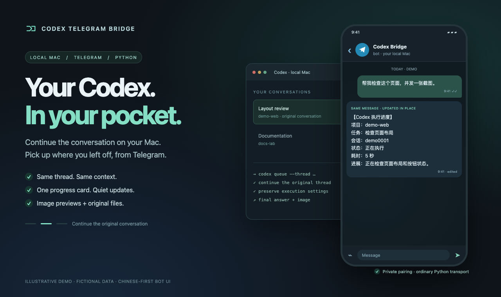
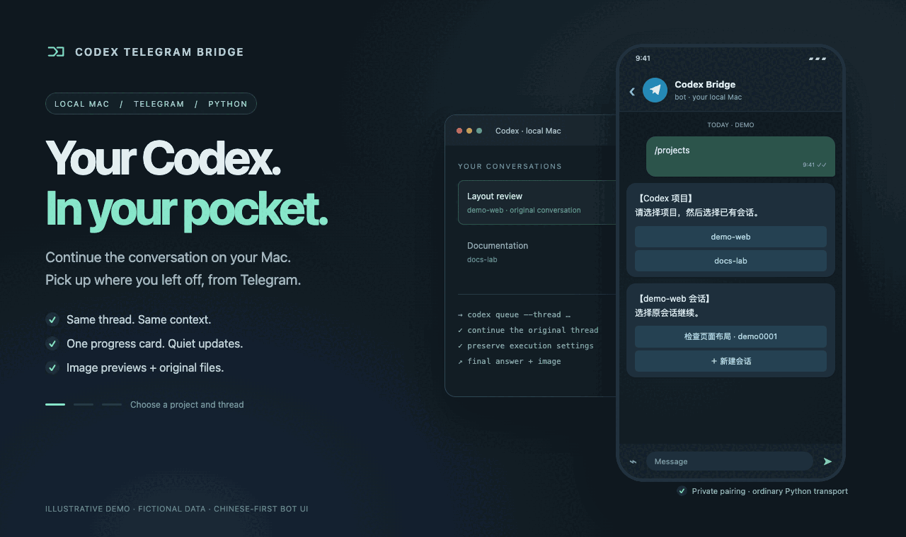

# Codex Telegram Bridge

**在 Telegram 里收结果、回消息，继续电脑上的 Codex 任务。**

[English](README.md) · 简体中文

Codex Telegram Bridge 是一个运行在 Mac 上的开源 Telegram 机器人。
你在手机上选择项目和会话、发送任务，电脑上的 Codex 负责执行，
再把进度和完整答复发回聊天。收到结果后，直接回复那条消息，
就能沿用原来的上下文和执行设置继续处理。

如果你平时更常看 Telegram，就可以把 Codex 的任务也放在这里跟进：
结果来了看一眼，需要调整就回一句，发现问题就发一张截图，
不用再切到另一个应用里找会话。

[官方手机端 Codex](https://learn.chatgpt.com/docs/mobile)也能连接自己的电脑、继续已有会话。
这个项目把常用的跟进操作放进 Telegram，并做好几个具体细节：

- **回复哪条结果，就继续哪条会话。** 后来切换了项目也不影响回复目标，
  不必先把当前项目切回去。
- **进度集中在一条消息里。** 可选进度卡片持续更新，完整答复另外送达；
  长内容自动拆分，不截断。
- **截图能发过去，结果图片能取原图。** 支持单张图片加说明；最终答复附带的本机图片
  可以回传预览，再按按钮取原图。启用自动清理后，接收副本保留 7 天，发送原图副本
  保留 30 天；执行中和等待发送的图片受到保护，项目原图保持不动。
- **自己部署，也能自己改。** 桥接服务只用 Python 标准库，源码以 MIT 协议开源。
  路由和通知无需额外调用调度模型，任务仍使用你已有的 Codex 账号和模型。





## 已经有官方手机端，为什么还做这个工具？

我长期用下来，最烦的就是 ChatGPT 里 Codex 的远程连接断断续续，连接失败肯定会碰到。
只是想补一句话，也要先等它连上，体验挺糟糕。

**这个工具把日常跟进放进 Telegram，不依赖官方 Remote 连接。**
电脑上继续用 Codex，手机上发消息、收结果、接着聊。

| 使用体验 | 官方手机端 Codex | 本项目的优势 |
| --- | --- | --- |
| 跟进任务 | 连接电脑，进入任务 | Telegram 直接收发，无需先等官方 Remote 连上 |
| 继续讨论 | 在对应任务中交流 | 回复结果就续接原会话，切换项目也不影响目标 |
| 查看进度 | 任务页面和通知 | 可选卡片更新同一条消息，完整答复留在聊天里 |
| 自定义 | 应用提供的功能和设置 | 开源自托管，可修改通知和图片管理规则 |

[官方端](https://learn.chatgpt.com/docs/mobile)仍适合审批命令、审阅代码和调整执行中的任务。
本项目适合常用 Telegram 的人；需要自行部署，并保持 Mac、Codex、桥接服务和 Telegram 网络可用。

## 和其他 Telegram 工具相比呢？

同类项目也已经支持会话续接、进度反馈和图片，选择时更值得看具体的工作方式：

| 项目 | 公开文档中的主要侧重 |
| --- | --- |
| [Codex Telegram Frontend](https://github.com/anton88vlc/codex-telegram-frontend/blob/fb3b296ab5675cd05449673f972bcc6c5852d751/README.md) | 面向 Desktop 的前端，用项目群和会话话题组织工作，提供审批、计划和文件变动进度 |
| [jvogan/telegram-codex-bridge](https://github.com/jvogan/telegram-codex-bridge/blob/e5ab6e2e94fac5bff80fe7bee1727ccd142de007/README.md) | 续接已有 Desktop 会话，支持文件、图片、语音及可选实时通话等扩展 |
| [Codex Telegram Bot](https://github.com/woosungchoi/codex-telegram-bot/blob/9a801ca39ad901bf623d8a3357308b4d7cc2e818/README.md) | 面向 CLI／SDK，提供项目与会话菜单、任务队列、设置和维护工具 |

本项目专注个人私聊：回复结果回到原会话，进度不刷屏，图片副本按规则清理。
用 Python 标准库部署，方便按自己的习惯修改。

## 功能

- `/projects`：项目按钮、搜索、翻页和最近使用排序。
- `/sessions`：当前项目的会话列表，每页五条；明确选择已有或新建会话。
- `/current`：当前目标、模型与推理设置；`/new`：下一条消息新建会话。
- `/status`：运行中的本机任务及任务详情；`/last`：补看最终答复。
- `/health`：接收、扫描、发送和工作线程心跳，以及消息队列状态。
- 可选执行进度卡片：复用任务接收消息，持续更新状态、耗时和最新公开进展，不逐条推送。
- `/cancel`：取消尚未提交的任务或停止 Bot 自己启动的 CLI 任务。
- `/steer 补充要求`：向选中或被回复的原会话当前回合追加要求；`/stop`：停止原回合。
- `/settings`：选择此会话的模型、推理和可用速度档位；`/usage`：查看额度、重置和上下文采样。
- 回复完成通知可续接对应的原会话，不受当前项目选择影响。
- 最终答复明确附带的本地图片可自动发送预览，图片下的“发送原图”按钮提供原始文件；
  回复图片或原图文件也会定位原会话。
- 可接收单张图片和同条消息中的文字说明，交给已选中或被回复通知对应的原会话处理。
- 长答复完整拆分；完成回调与本地事件观察器按会话和回合去重。
- 观察器按会话保存读取进度，归档或恢复记录不会从头补推；仅转发监控启用后的完成事件，
  并显示事件的实际完成时间。旧路径进度自动迁移，缺少有效时间的扫描事件不会作为新通知发送。
- 桌面会话通过官方 `codex queue --thread` 交回 Desktop；Bot 创建的 CLI 会话使用 `codex exec resume`。

只有配对成功的私人聊天和用户可以发起任务。完成通知表示模型回合结束，
不保证业务验收成功；Telegram 发送回执也不表示收件人已读。

## 环境要求

- macOS，Python 3.9 或更新版本，仅使用标准库。
- 已安装、登录 Codex；续接桌面会话需要 Desktop 运行，且其 CLI 支持 `queue --thread`。
- Telegram BotFather 创建的专用 Bot，不应被其他轮询程序或 webhook 共用。
- 本机 Codex 的 `state_5.sqlite` 与 rollout 记录。其内部结构可能随版本变化。

无需安装第三方 Python 包，也不需要 Telegram 的 `api_id`／`api_hash`、公网服务器或开放入站端口。

默认 CLI 路径为 `/Applications/ChatGPT.app/Contents/Resources/codex-cli/bin/codex`。
CLI 安装位置不同时，通过环境变量指定。注意：当前 Desktop 运行检测仍只识别
`/Applications/ChatGPT.app/Contents/MacOS/ChatGPT`；单独修改 CLI 路径不能改变这一限制。

```sh
export CODEX_CLI="/absolute/path/to/codex"
export CODEX_THREAD_DB="$HOME/.codex/state_5.sqlite"
```

`CODEX_HOME` 可调整默认 Codex 数据目录。使用 LaunchAgent 时，需在其环境中
明确设置这些值。时间显示目前固定为 `Asia/Shanghai`。

## 配置与启动

以下流程在终端中运行服务，不安装后台服务。所有命令都在源码目录执行，并使用同一个 Python。

1. **下载源码，进入目录。** 已安装 Git 时运行：

   ```sh
   git clone https://github.com/wyfblues/codex-telegram-bridge.git
   cd codex-telegram-bridge
   chmod 700 .
   ```

   也可以下载 GitHub ZIP，解压后在源码目录打开终端，并运行 `chmod 700 .`。源码与运行数据共用这个目录，
   私有运行文件由 `.gitignore` 排除。

2. **先检查 Python 和 Codex。** 在电脑上打开 Codex、登录，并在准备接入的项目目录中
   创建会话，发送一条简单文字并等答复结束；只打开空白会话可能尚未生成可续接的记录。
   然后检查默认 CLI：

   ```sh
   python3 --version
   export CODEX_CLI="/Applications/ChatGPT.app/Contents/Resources/codex-cli/bin/codex"
   "$CODEX_CLI" --version
   "$CODEX_CLI" queue --help
   ```

   Python 需为 3.9 或更新版本，CLI 必须能运行，`queue` 帮助中应有 `--thread`。
   不满足时先解决安装或版本兼容问题。当前 Desktop 运行检测只识别上方列出的
   `ChatGPT.app` 进程路径；仅修改 `CODEX_CLI` 不能解决 `Codex.app` 等其他安装名称的兼容性，
   不要通过重命名应用绕过检测。

   会话发现还需要已有的 Codex 数据库，默认是 `$HOME/.codex/state_5.sqlite`。
   位置不同时，在当前终端设置 `CODEX_THREAD_DB` 为其绝对路径；不要创建空库，
   也不要复制别人的数据库。CLI 路径不同时，修改上面的 `CODEX_CLI` 值。
   将来使用 LaunchAgent 时，也需在它的环境中设置这些变量。

3. **创建自己的 Bot，完成配对。** 在 Telegram 打开官方 [BotFather](https://t.me/BotFather)，
   发送 `/newbot`，按提示填写显示名称和以 `bot` 结尾的用户名，取得自己的 Bot Token。
   可参考 [Telegram 官方创建说明](https://core.telegram.org/bots/features#creating-a-new-bot)。
   使用专用 Bot，不要与其他轮询程序或 webhook 共用。然后运行：

   ```sh
   python3 bridge.py setup
   ```

   在 `Paste BotFather token (hidden):` 后粘贴 Token，输入不会显示。
   不要把 Token 写进命令、README、Issue 或 Telegram 消息。接下来会询问代理：

   - Mac 能直接连接 Telegram：直接回车，留空。
   - 需要代理：填写自己的 HTTP 代理地址，例如 `http://127.0.0.1:7890`，端口按实际修改。
     当前不支持 SOCKS 地址。

   留空会直连，不会自动沿用系统代理或 `HTTPS_PROXY`。`setup` 的代理通过这个输入框填写，
   不要用 `setup --proxy` 传入。

   保持终端打开，进入它打印出的 Bot 链接，从自己的私人账号向 Bot 发送**完整的**
   `/start <challenge>`，其中验证码必须使用终端本次显示的值。只点“开始”不够。
   配对窗口约十分钟；成功后终端显示 `Paired.`，并生成 `token`、`settings.json`
   （两者权限均为 `0600`）和 `state.sqlite3`，远程执行默认关闭。
   聊天 ID、用户 ID 和 Bot ID 都会自动生成，无需自己查找填写。

4. **配置项目。** 用纯文本编辑器打开刚生成的 `settings.json`，在原文件中修改这些字段：

   ```json
   {
     "projects": {
       "demo": "/absolute/path/to/your/project"
     },
     "execution_enabled": true
   }
   ```

   示例路径要换成已经存在的项目绝对目录，并与 Codex 会话的工作目录完全相同。
   不要用 `~`、另一个 worktree 或符号链接别名。`demo` 是菜单名称，可以自行修改。
   `execution_enabled: true` 会允许已配对账号发送任务。
   上面是**配置片段**，不能整段替换原文件；保留配对生成的 `proxy`、`chat_id`、
   `user_id`、`bot_id` 和 `bot_username`。不要用 `settings.example.json` 覆盖原文件。

   进度、图片发送、图片接收和清理默认关闭。需要时，在原配置中添加
   `progress_cards_enabled`、`image_delivery_enabled`、`image_receive_enabled`、
   `image_cleanup_enabled` 并设为 `true`。检查 JSON 语法时无需打印私人配置：

   ```sh
   python3 -m json.tool settings.json >/dev/null
   ```

   `new_thread_defaults` 留空时沿用个人 Codex 配置；也可添加 `model` 和
   `model_reasoning_effort` 来指定新建会话的默认设置。

5. **注册菜单，启动并验收。** 注册一次即可，成功输出包含 `"verified": true`；随后启动前台服务：

   ```sh
   python3 configure_menu.py
   python3 bridge.py run
   ```

   保持终端打开、Mac 唤醒并联网。服务空闲时可能没有输出。在配对的 Telegram 私聊中：

   - 发送 `/health`，确认远程执行已启用，接收、发送、执行和观察器心跳近期更新，且没有持续异常。
   - 发送 `/projects`，选择项目和空闲的已有会话；再用 `/current` 确认目标。
     尚无会话时，先在电脑上的 Codex 同一目录创建会话，完成一次简单文字交互，再刷新 `/sessions`。
   - 发送一个小测试：`只回复：连接成功。不要修改文件或运行命令。`
     确认选定的原会话实际执行，并且完整答复回到 Telegram。只看到 `/health` 回复不能证明这一步。

之后修改配置时，等任务和发送空闲，用 Ctrl+C 停止**自己启动的**前台服务，修改后重新运行。
不要让两个服务同时轮询同一个 Bot。仓库附带的 `.command` 脚本只负责配对，
不会注册菜单或启动服务。长期运行可自行配置用户级 LaunchAgent，使用绝对路径和私人日志目录。
时间显示目前固定为 `Asia/Shanghai`。

## 安装时遇到问题

终端会隐藏异常详情，因为网络错误可能带有 Token URL。可以结合异常类型、Telegram 错误码和失败阶段判断：

| 现象 | 检查与处理 |
| --- | --- |
| 找不到 `python3`、版本低于 3.9 或导入失败 | 安装兼容的 Python，所有命令使用同一个解释器；无需第三方 Python 包。 |
| 首次启动前出现 `FileNotFoundError` | 进入源码目录并先完成 `setup`，确认这里已有 `token` 和生成的 `settings.json`。 |
| 配对时出现 `Rejected`，Telegram 错误码 401 或 404 | 检查 BotFather 提供的 Token；若尚未生成 `settings.json`，可重新运行 `setup` 输入正确 Token。 |
| 尚未出现配对链接就报 `RuntimeError` | 若已有 `settings.json`，会拒绝重复配对，应编辑原配置；否则先重新复制完整的 BotFather Token，去掉多余空白；也可能是 Bot 已有 webhook，请使用新的专用 Bot。程序不会删除 webhook。 |
| 显示配对链接后等待超时 | 向正确 Bot 的私聊发送本次完整验证码。尚无 `settings.json` 时，重新运行 `setup` 取得新验证码。 |
| `URLError`、超时或轮询持续失败 | 检查 Telegram 连通性及显式填写的 HTTP 代理；若为 HTTPS 证书错误，应修复 Python 的证书信任，不要关闭 TLS 校验。 |
| Telegram 错误码 409 | 可能有另一个程序在轮询同一 Bot；停止自己重复启动的实例，或改用独立 Bot，不要停止无关服务。 |
| 编辑配置后出现 `JSONDecodeError` 或启动失败 | 执行上方 JSON 语法检查，修复原文件并保留配对字段；`projects` 应是名称到绝对目录的对象。 |
| 启动时出现 `BlockingIOError` | 此源码目录已有服务运行，不要再启动一份，也不要删除锁文件。 |
| 会话列表为空或观察器持续异常 | 打开 Codex，检查其数据库位置、兼容性及可读权限；列表为空时还要检查项目目录与会话工作目录是否完全一致。 |
| `DESKTOP_OFFLINE`、`START_FAILED` 或 CLI 不支持 `queue --thread` | 重做第 2 步的 Desktop 和 CLI 检查；配对成功不代表 Codex 兼容。提交结果待确认时，不要盲目重复发送任务。 |

## 一个目录，选择性纳入 Git

源码和本机运行数据放在同一个目录，不需要维护第二份代码或同步目录。
Git 只跟踪源码、测试、示例配置和文档。Token、真实配置、数据库、日志与备份
始终留在本机，并由 `.gitignore` 排除。不要使用 `git add -f` 强行添加这些文件。

发布流程：从 `main` 创建功能分支 → 修改并测试 → 检查差异和提交 → 推送分支并提交
PR → CI 通过后合并 `main`。具体约定见 [贡献说明](CONTRIBUTING.md)。

本机启用单独进行：确认 Bot 任务和消息发送均空闲，再重启服务并用 `/health` 检查。
服务不会自动热重载；notify 回调是
短进程，下次调用会读取新代码。不要用旧数据库或旧个人配置覆盖现有运行数据。

## 可选的完成回调

服务自带本地结束事件观察器。还可以在个人 Codex `config.toml` 配置 `notify`，
指向唯一源码仓库中的 `notify_hook.py`，与观察器去重。修改前保存已有回调；若存在，
将其命令数组保存在运行目录的 `original-notify.json` 中，由新回调继续调用。
不要直接覆盖已有回调或提交原始个人配置。

```toml
notify = ["/absolute/path/to/python3", "/absolute/path/to/notify_hook.py"]
```

全面停用时，同时停止服务并恢复原 notify 回调。只停止后台服务，回调仍可能入队。

## 执行进度卡片

在个人 `settings.json` 中将 `progress_cards_enabled` 设为 `true`，通过离线测试后，
等 Bot 任务与发送队列空闲再重启服务。默认关闭；`/health` 显示开关状态。

Telegram 发起的任务复用接收回执作为进度卡片；启用后新开始的本机主会话回合也会有
一张卡片。卡片显示项目、会话、排队或执行状态、耗时，以及最新一条明确标为公开
commentary 的进展，以及结构化待办、修改文件摘要、模型和上下文采样。快速变化会合并，
同一条消息每 10 秒最多编辑一次。不会发送推理、完整代码差异、
工具日志、用户输入或无法确认属于当前回合的文字，也不会补推启用或重启前的历史卡片。

结束、失败、取消或确认中断后冻结卡片耗时；“本轮已结束”仅表示 Codex 回合结束。
完整最终答复及图片另外发送，并关联已确认的原始手机消息；可回复卡片继续原会话。
启用手机控制后，可用 `/stop` 请求停止 Desktop 原回合。提交不确定或服务重启不会自动重跑。

卡片编辑失败不会另发替代消息。限流遵守等待时间并合并新进度；消息被删除或拒绝编辑
后停止更新。首次发送结果不确定时不会重发。关闭开关后停止新卡片与已有卡片编辑，
任务执行、原有通知和图片功能继续使用原流程。进度监听和编辑均由普通 Python 完成。

## 手机控制与额度

测试通过后，在个人配置启用 `remote_controls_enabled`，等 Bot 任务和发送队列空闲再重启。
`/settings` 提供模型、推理强度和模型目录明确支持的 Fast 档位；也可发送 `/model 模型名`、
`/reasoning 强度`、`/fast on` 或 `/fast off`。只调整此会话的下一轮设置，运行中不修改，
不写全局 Codex 配置、不改变权限或目录。Bot CLI 会话保存自己的手机提交选项。

`/steer 补充要求` 是显式追加；普通消息仍沿用原续接规则。当前 Desktop IPC 把追加要求
交给原会话处理时的活跃回合，接口不能原子锁定回合；停止操作则严格核对原回合 ID。
只连接已有 Desktop 会话拥有者或已有官方 app-server socket，不接管 writer，不另起会话。
会话未加载、控制通道不可用或结果未知时明确提示，不自动重发；服务恢复也不重放控制请求。

`/usage` 查询本机登录账号共用额度和重置时间，并显示选中会话的最近上下文采样；未知和
过期值单独标明。模型目录和额度查询由只读短进程完成，不启动线程或推理任务。
启用 `rich_messages_enabled` 后，最终答复可显示代码块、粗体、链接和列表；HTML 被明确
拒绝时回退相同内容的纯文本。权限审批和执行中的结构化问题答复尚不在此功能范围内。

## 图片预览与原图

在个人 `settings.json` 中将 `image_delivery_enabled` 设为 `true`，并在没有 Bot
任务执行或消息发送时重启服务。默认关闭；`/health` 显示当前图片发送开关。

任务最终答复应使用 Markdown 图片语法附上本机绝对路径，例如：

```md


```

普通图片默认发送预览，并带“发送原图”按钮；以 `原图` 或 `original` 开头的
图片说明会直接发送文件。PNG、JPEG 在 10 MB 内优先预览；GIF、WebP、较大图片，
以及 Telegram 明确拒绝的预览会按原图文件发送。单张文件最大 50 MB，单轮最多 10 张，
超限或文件不可读会单独提示，文字答复仍然发送。图片说明过长时只截短图片 caption，
最终文字答复仍保留全文。

只读取最终答复明确附带的本地图片，不遍历项目或工具日志；不下载远程图片，
不处理代码示例中的图片链接，也不补发启用前的历史图片。纯工具画面需先保存成文件。
Telegram 发起的任务会自动收到交付格式提示；桌面直接执行的任务也可使用上述格式。

图片入队时复制到被 Git 忽略的私有 `media/` 目录，按内容校验，防止源文件随后变化。
原图按钮不调用模型，同一张预览重复点击只入队一次；发送超时维持“送达待确认”，
不会盲目重发。启用自动清理后，原图副本保留 30 天，图片回执和会话关联继续保留。
关闭图片发送开关会停止新任务的图片自动入队；已入队消息和已有原图按钮仍可使用。

## 接收单张图片与说明

在个人 `settings.json` 中将 `image_receive_enabled` 设为 `true`，远程执行也须启用，
安全重启后 `/health` 会显示“图片接收：已启用（单张图片＋说明）”。

先用 `/projects`、`/sessions` 选择已有会话，然后在 Telegram 选择一张照片，
在发送图片的说明栏填写要求，例如“帮我看看这个报错”，一起发送。
也可以回复某条任务完成通知，附一张照片和说明，消息会继续那条通知的原会话。
图片回复仍优先于当前项目选择，接收后切换项目不会改变已经固定的任务目标。

第一版仅支持普通图片消息中的一张 PNG/JPEG 图片与同条 caption，不支持相册、
以文件形式发送的图片、没有说明的图片或自动创建新会话。没有选定原会话时会明确提示。
Telegram 的 `photo` 列表是同一张图片的多种分辨率，服务会选择最大的可用版本；
图片方式可能已经由 Telegram 压缩，下载版本最大 20 MB。超过十五分钟的消息不执行。

身份和任务目标校验通过后，普通 Python 工作线程下载图片到私有 `incoming/`，
在提交前检查内容校验值。桌面会话的官方 `codex queue` 当前拒绝原生图片附件，
因此把本机图片路径与“先调用图片查看工具再回答”的要求交给原会话；
CLI 原会话使用 `resume --image` 附件参数。两种方式都保留原会话执行设置。
若原模型或工具无法查看图片，应明确告知，不能猜测图片内容。

入队只是接收成功，图片下载、会话提交和识图完成是不同步骤。下载或校验失败不会启动
任务；提交结果不确定时不自动重试。收到新图片不会运行额外的分发模型。
`incoming/` 由 Git 忽略，权限仅限当前用户。启用自动清理后，接收图片保留 7 天。

## 图片自动清理

在个人配置启用 `image_cleanup_enabled` 并安全重启后，服务启动时和此后每小时检查一次。
接收图片 `incoming/` 保留 7 天，发送原图副本 `media/` 保留 30 天，按最近一次接收或
交付及副本文件更新时间中较新的时间计算；相同内容的新交付会延长共享副本的保留期。

正在排队或执行的任务、待发送/发送中/送达待确认的图片，以及排队或执行中的原会话所关联的
图片，均暂不删除；共享文件只要有任意受保护引用就保留。无法确认原会话运行状态时，
本次清理跳过。保护解除后，已超过保留期的图片会在下一次检查清理。

清理仅处理上述两个私有目录下由 Bot 管理的内容校验文件名，不递归、不跟随符号链接，
不删除项目里的原始图片、聊天文字、消息回执、会话映射或凭据。清理前再次检查文件是否
被替换，图片入队/保存与清理使用数据库事务串行协调。旧副本和异常退出留下的完整图片
会自动纳入检查，其他文件不会清理。

过期原图按钮会提示“原图本机副本已过期或已清理（保留 30 天）”，不再入队发送；
已经发送过的原图仍可在 Telegram 聊天记录中查看。接收图片清理后，原会话仍保留聊天
文字，若要再次查看旧图，需要重新发送。清理由普通 Python 完成，不调用模型；
`/health` 显示开关、上次检查时间和删除数量。个别文件删除失败不会中断收发服务。

## 执行与隐私边界

- 任务在本机执行，沿用 Codex 权限和项目指令。已有会话设置无法保留时拒绝续接。
- 桌面提交被接受不等于完成；仅跟踪关联的请求与回合。超时或重启后不自动重复提交。
- `/stop` 可请求停止兼容且已加载的 Desktop 原回合；通道不可用时仍需在桌面停止。
- 一次处理一个 Telegram 执行任务；接收图片目前仅支持单张图片＋同条说明，
  暂不支持其他附件、语音、群聊或多用户。
- 超过十五分钟的待提交指令不会静默执行。Mac 睡眠、断网或关机时不能接收任务。
- CLI 工作进程使用绑定其 PID 的保活，结束后释放；本仓库不包含个人电脑常驻保活服务。
- 通知包含会话标题、项目名称与最终答复，并经 Telegram 传输。不要让最终答复包含秘密。
  内置处理会隐藏本 Bot 的精确 Token，但不是通用敏感信息检测器。
- 本地状态库含任务文字、通知内容、配对与回执信息，应保留在受保护的运行目录。
- Telegram 发送结果不确定时不会自动重发；限流会遵守 `retry_after`。
- 依赖 Codex 当前的数据库、事件格式和 CLI 输出，升级后应重新验证兼容性。

## 开发与提交

```sh
python3 -m unittest discover -p 'test_*.py'
```

离线测试使用临时数据库及虚构数据，不需要真实 Token，也不会向真实配对账号发送消息。
真实收发验收须经用户授权，仅发送独立测试图片，并核对回执、原图内容与消息去重。
`.gitignore` 排除凭据、运行设置、数据库、日志、备份和本机资源。提交前仍应检查
`git diff --cached` 与 `git ls-files`；忽略规则无法清除已经进入历史的秘密。

## 许可证

本项目以 [MIT License](LICENSE) 开源。Codex 与 Telegram 是各自所有者的产品；
本项目独立维护，不是其官方产品，也未获得官方背书。

## 设计参考

以下项目用于交互和可靠性设计参考；不作为安装或运行依赖：

- [Codex Telegram Frontend](https://github.com/anton88vlc/codex-telegram-frontend)
- [Takopi](https://github.com/banteg/takopi)
- [codex-telegram-bot](https://github.com/woosungchoi/codex-telegram-bot)
- [tele-codex](https://github.com/emanuel-prado/tele-codex)
- [Telegram Bot API](https://core.telegram.org/bots/api)
